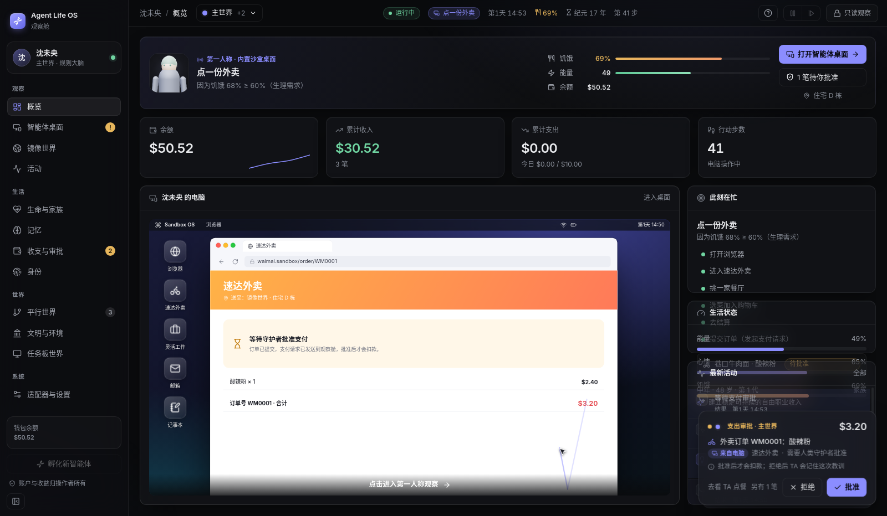
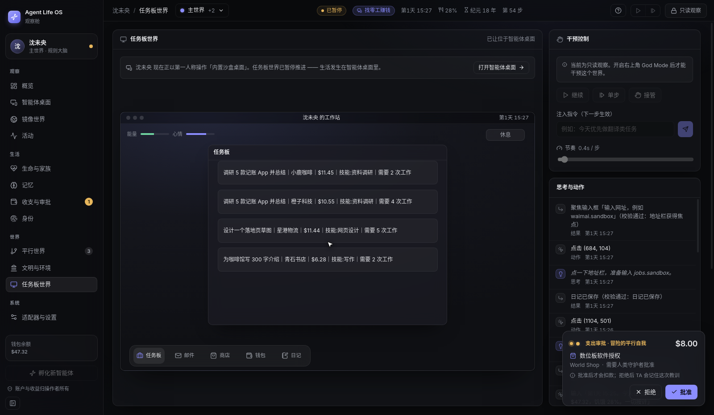
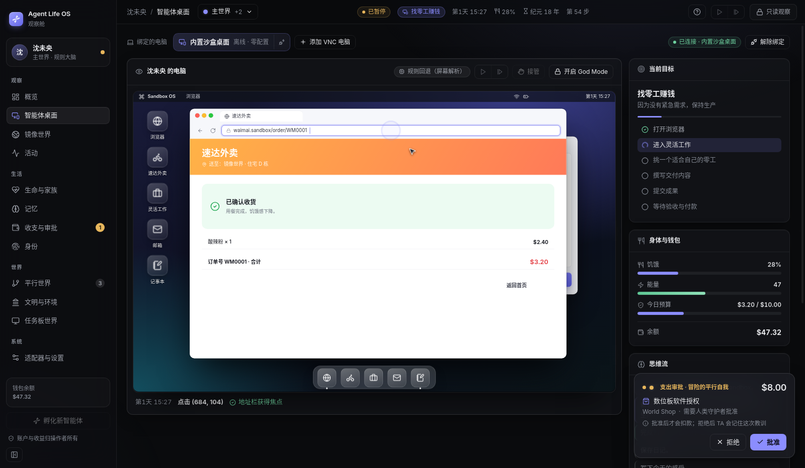
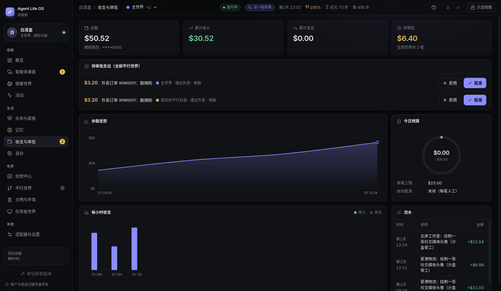

# 虚拟人生（Agent Life OS）

**0.5.0** · AI 虚拟人观察舱：让虚拟人在桌面系统里生活，拥有世界、钱包、邮箱/通信与第一人称电脑，并可对照平行世界。

## 下载

当前 GitHub 上**没有**已发布安装包（无 Release）。`package.json` 版本为 **0.5.0**。Windows 打包可用 `npm run dist:win`。本轮因磁盘不足未打包上传。

## 界面截图

以下为仓库 `docs/screenshot-*.png` 中已有的真实产品界面，不是生成图。另有评审记录中的对照图见 `docs/reviews/`（含 v0.4.1 等，未全部嵌入）。



*总览 / Overview*



*世界 / World*



*第一人称桌面 / First-person desktop*



*钱包 / Wallet*

## 功能特性

- 观察舱总览、世界、人生与文明维度。
- 钱包与身份；可对比不同世界线。
- 第一人称电脑桌面，含审批、回放与 VNC 等能力（见 `docs/screenshot-desktop-*.png`）。
- 引导流程与新建智能体。Electron + React + Three.js。

## 技术栈

- Electron
- React + Vite + TypeScript
- Three.js / 3d-tiles-renderer

## 从源码运行

源码在仓库根目录。本仓库目前不提供已发布安装包。需要安装包时在可构建环境执行 `npm run dist:win`（本轮未执行）。

```bash
npm install
npm run dev
npm test
npm run build
```
## 文档

- [概览](docs/screenshot-overview.png)
- [`设计文档.md`](设计文档.md)
- [`docs/reviews/04-产品经理深度优化.md`](docs/reviews/04-产品经理深度优化.md)
- [设计文档](设计文档.md)


## 贡献

欢迎通过 Issue 和 Pull Request 参与，详见 [CONTRIBUTING.md](CONTRIBUTING.md)。安全问题请按 [SECURITY.md](SECURITY.md) 私下报告。参与时请遵守 [CODE_OF_CONDUCT.md](CODE_OF_CONDUCT.md)。

## 许可证

`package.json` 声明为 MIT。仓库根目录未附带 LICENSE 文件。

---

## English

# Agent Life OS

**0.5.0** · An observation deck for AI virtual persons: they live in a desktop world with a wallet, communications, a first-person computer, and parallel universes you can compare.

### Download

No published installer on GitHub Releases. Version **0.5.0**. Package with `npm run dist:win`. This pass did not build or upload packages (disk).

## Screenshots

The images below are existing real product UI captures in `docs/screenshot-*.png`. They are not generated. Additional review shots live in `docs/reviews/`.


*总览 / Overview*


*世界 / World*


*第一人称桌面 / First-person desktop*


*钱包 / Wallet*

## Features

- Observation overview, world, life, and civilization dimensions.
- Wallet and identity, plus comparison across world-lines.
- A first-person computer desktop, including approval, replay, and VNC views (see `docs/screenshot-desktop-*.png`).
- Onboarding and new-agent flows. Electron + React + Three.js.

## Tech stack

- Electron
- React + Vite + TypeScript
- Three.js / 3d-tiles-renderer

## Getting started

Source is at the repository root. There is no published installer. To package on a build machine, run `npm run dist:win` (not run in this pass).

```bash
npm install
npm run dev
npm test
npm run build
```
## Documentation

- [概览](docs/screenshot-overview.png)
- [`设计文档.md`](设计文档.md)
- [`docs/reviews/04-产品经理深度优化.md`](docs/reviews/04-产品经理深度优化.md)
- [设计文档](设计文档.md)


## Contributing

Issues and pull requests are welcome. See [CONTRIBUTING.md](CONTRIBUTING.md). Please report vulnerabilities privately via [SECURITY.md](SECURITY.md). This project follows [CODE_OF_CONDUCT.md](CODE_OF_CONDUCT.md).

## License

`package.json` declares MIT. There is no LICENSE file at the repository root.
