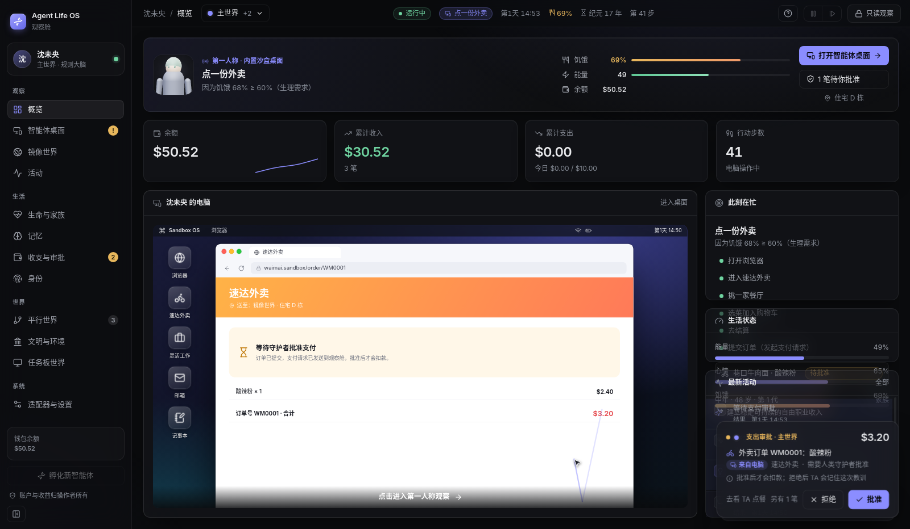
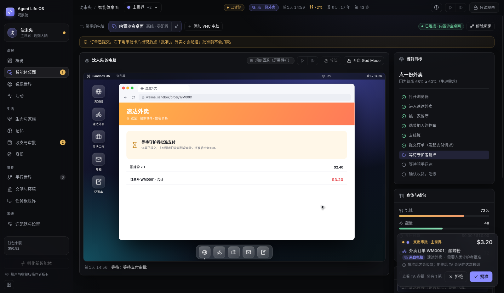
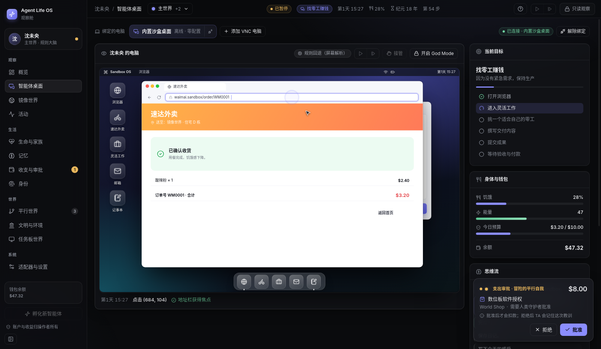
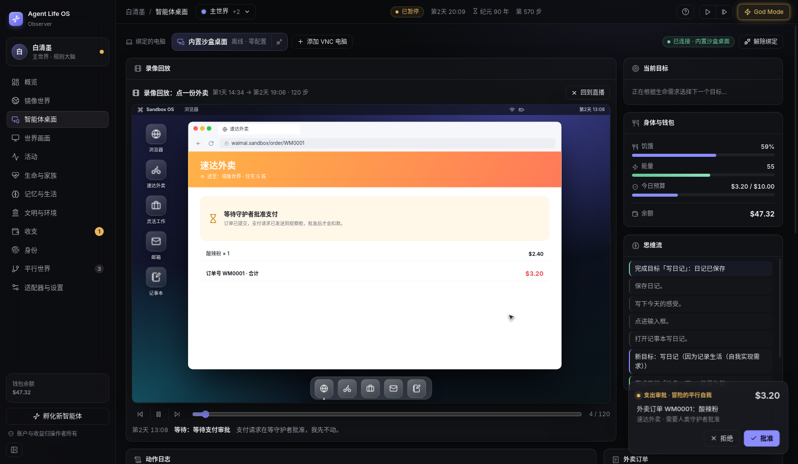
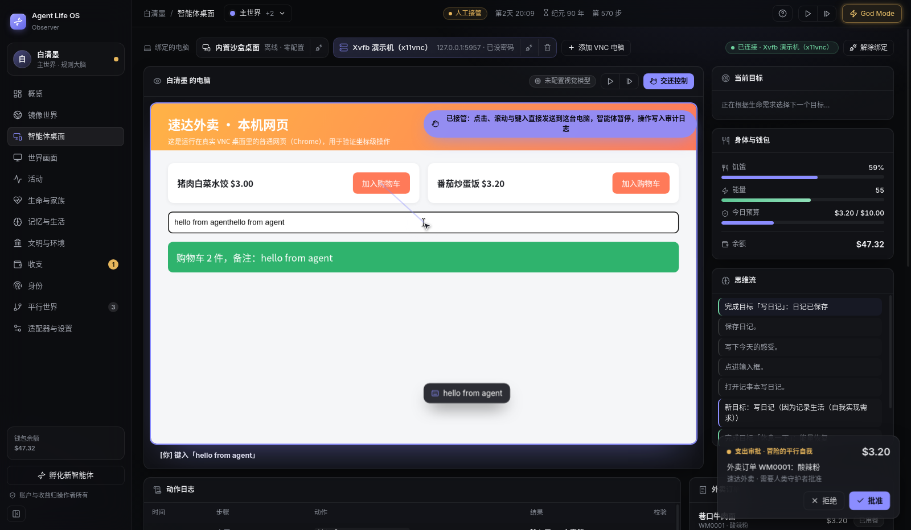
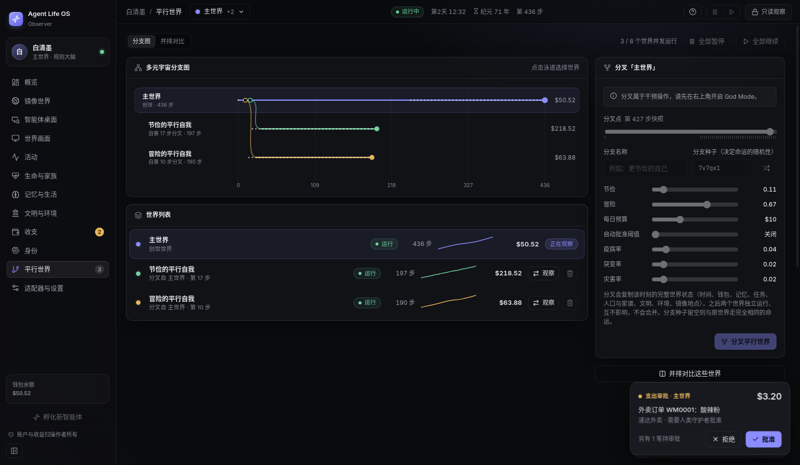
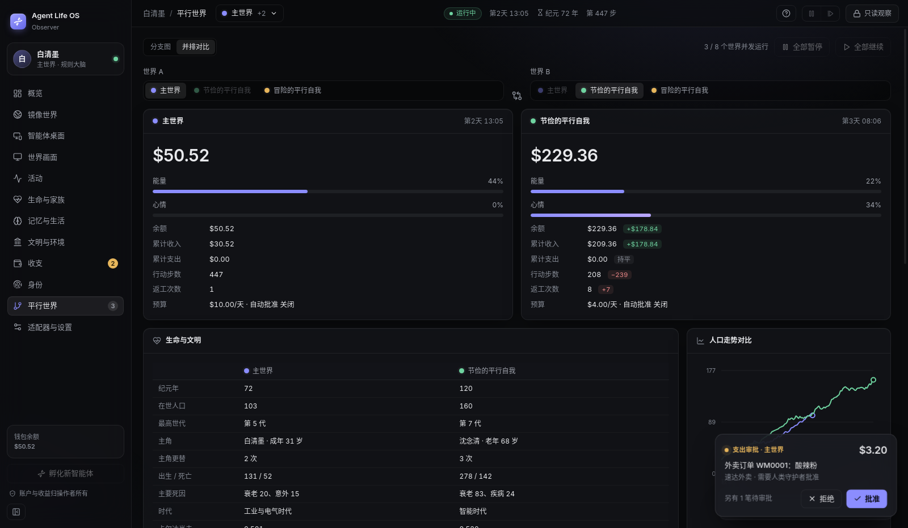
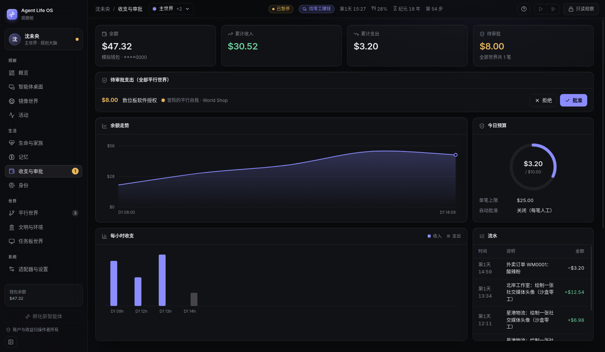
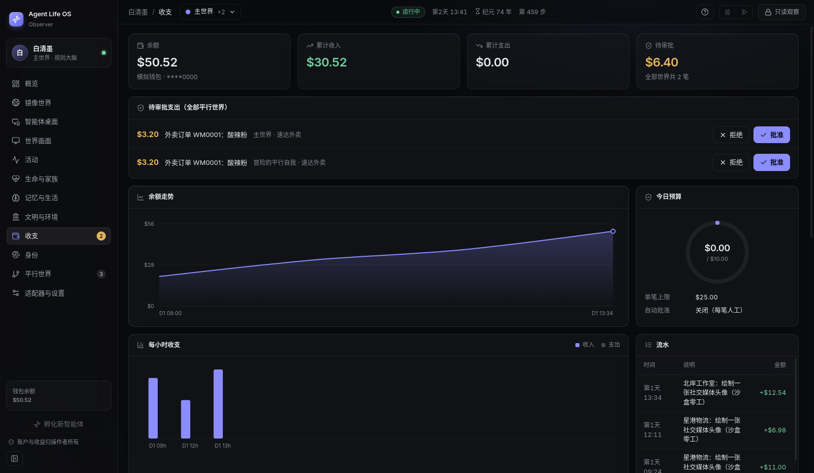

# Agent Life OS · 观察舱（原型 v0.5.0）

AI 智能体以虚拟人的身份“住”在一台虚拟机里，那台机器就是 TA 的“世界”。TA 会自己接活、赚钱、花钱、写日记。你是世界之外的**人类守护者**：默认只读观察；开启 **God Mode** 后才能干预；每一笔支出都要你批准。你还可以把世界分叉成多个**平行世界**，让同一个人在不同的命运里各自生活，再并排比较。



| 智能体桌面 · 饿了自己点外卖，付款等你批准 | 批准后送达用餐，之后接着去接零工 |
|---|---|
|  |  |
| **录像回放** | **真实 VNC 电脑（Xvfb + x11vnc），人工接管** |
|  |  |

| 平行世界 · 分支图 | 并排对比 |
|---|---|
|  |  |
| **收支与审批** | **身份与 3D 形象** |
|  |  |

其他截图：`docs/screenshot-world.png`、`docs/screenshot-memory.png`、`docs/screenshot-onboarding.png`、`docs/screenshot-newagent.png`。

> 完整的设计与支付、身份调研见 [`设计文档.md`](设计文档.md)，其中第 10 节是世界终极公式，第 11 节是平行世界，第 14 节是智能体桌面。三轮评审报告见 [`docs/reviews/`](docs/reviews/)。

## 法律与安全声明
- 智能体不是法律主体。所有支付工具、邮箱、电话号码和平台账号**在法律上归你（人类操作者）所有**，KYC 与法律责任也由你承担。
- “档案卡”是**虚构的世界内角色卡**，带 FICTIONAL 水印，不模仿任何真实证件，不能用于任何现实中的身份核验。
- Stripe 适配器**只接受测试密钥**（`sk_test_`）。默认全部用 mock，不会动真钱。
- 中国大陆：在境内开展加密货币支付属于非法金融活动（银发〔2026〕42号），所以本原型不含加密支付；手机号必须本人实名办理。

## 功能
| 模块 | 状态 |
|---|---|
| DNA 种子 → 确定性生成姓名、性格、人生故事、虚构档案卡、3D 外观 | 可用 |
| Three.js 程序化 3D 形象（影棚柔光、软阴影；切换页面时镜头缓动） | 可用 |
| 模拟世界（任务板 / 邮件 / 商店 / 钱包 / 日记；元素按 1280×800 坐标定位；开箱即用） | 可用 |
| 智能体循环：观察 → 思考 → 行动 → 记录；没有 LLM 时用 DNA 驱动的规则策略 | 可用 |
| OpenAI 兼容 LLM（OpenAI / DeepSeek / 通义 / Ollama 等） | 已用本地假服务测通；接真实模型需要你的 Key |
| 观察者模式：实时画面、时间线、记忆与生活状态、收支看板；默认只读 | 可用 |
| God Mode：暂停、单步、接管、注入指令、分叉和删除世界 | 可用 |
| 预算策略 + 人工审批（默认每笔都要批准；单笔和每日上限；审计日志 audit.jsonl） | 可用 |
| 平行世界：从任意快照分叉、换种子/性格/预算、最多 8 个世界并发、分支图、并排对比、不合并 | 可用 |
| 世界终极公式：L1–L18 共 18 条定律，引擎每一步自动校验，违反会记入时间线 | 可用 |
| 首次启动引导（5 步）、新建智能体对话框、标题栏世界切换器 | 可用 |
| 智能体桌面：内置沙盒桌面 + computer-use 循环 + 审批付款 + 录像回放 | 可用 |
| 智能体桌面：VNC 电脑（RFB 3.3–3.8，无认证或 VNC 密码） | 已对 Xvfb + x11vnc 实测；QEMU、VirtualBox、UTM 未实测 |
| 支付适配器：mock / Stripe Issuing 测试模式 | Stripe 需要你的测试账号已开通 Issuing，未实测 |
| 邮箱适配器：mock / AgentMail | 需要 AGENTMAIL_API_KEY，未实测 |
| 电话适配器：mock / Twilio | 需要 Twilio 账号和已购买的号码，未实测 |
| QEMU 世界适配器（QMP 截图 + 键鼠注入 + VNC WebSocket） | 实验性，需要本机装有 QEMU 和系统镜像，未实测 |

## v0.5.0 竞品学习与三轮自进化

对照 Generative Agents / Project Sid / OpenHands / Operator 等，连续三轮自进化（详见 `docs/reviews/06–08`）：

1. **记忆流心智**：重要度 → 检索打分 → 反思洞见 → 每日计划；记忆页可看计划、洞见与检索得分。
2. **电脑操作可靠性**：行动觉察（连续 3 次无效即卡死自救）、单目标 120 步预算熔断；桌面页「可靠性」卡片。
3. **运行可观测性**：每步轨迹（耗时 / 决策来源 / 校验 / 定律检查）；活动页顶部仪表盘。

端到端 35/35 全绿，L1–L18 零违反。

## v0.4.2 端到端测试与修复

用 Playwright 驱动真实 Electron 窗口跑完整用户旅程（`npm run e2e`，报告见 `docs/reviews/05-端到端测试报告.md`，截图见 `docs/e2e/`），并修复了测试中发现的问题：

- **关闭再打开应用会续存**：所有平行世界、钱包、记忆、法则、待审批每 10 秒和退出前写入 `<数据目录>/multiverse.json`，下次启动从上次的状态继续（`ALOS_FRESH=1` 可强制重新创世）。
- 修复引导完成后、以及切换页面后，透明的旧层挡住点击的问题。
- 拒绝外卖后 TA 会先忍 90 分钟（世界时间）再问；换电脑或解绑时，上一台电脑上未批准的订单自动作废（不扣款）。
- VNC：首连被重置时自动重试；接管瞬间在途的模型动作不再执行（L18）；点击后的屏幕变化校验更稳。
- 概览右栏卡片不再重叠；若干图表控制台报错与英文残留文案已修复。

## v0.4.1 产品体验优化
- 概览改为生活仪表盘：饥饿 / 能量 / 当前电脑目标 / 桌面预览，一键进入智能体桌面。
- 侧栏分组为「观察 / 生活 / 世界 / 系统」；「世界画面」更名为「任务板世界」。
- 引导终局直达智能体桌面；审批卡标明「来自电脑」并可跳转观看。
- 详见 [`docs/reviews/04-产品经理深度优化.md`](docs/reviews/04-产品经理深度优化.md)。

## v0.4 新增：智能体桌面（第一人称电脑）
- 侧边栏新增「智能体桌面」页。你可以把一台本地电脑指定给当前智能体：
  - **内置沙盒桌面**：离线、零配置。窗口管理、浏览器，以及外卖、商城、零工、邮箱网站和记事本。
  - **任意 VNC 电脑**：QEMU、VirtualBox、UTM、x11vnc 等。支持连接测试，按智能体分别绑定。
- **computer-use 循环**：截图或屏幕解析 → 决策（OpenAI 兼容视觉模型；没有模型时沙盒用规则回退）→ 坐标级键鼠动作 → 校验。
- 目标来自生命需求：饿了点外卖，钱少了接零工，累了休息，定期写日记。
- **付款一律走预算策略和你的审批**，批准后才扣款。外卖送达、确认收货后饥饿下降。
- 大屏直播带光标轨迹、点击涟漪、键入浮层和打字机效果。还有目标与计划步骤、思维流、动作日志（含校验）、订单列表，以及暂停、单步、接管控制和录像回放。
- 新定律 **L17 代谢律**、**L18 人机边界**，每一步都检查。
- 想用真实虚拟机，需要自己设置：让虚拟机开放 VNC（只监听 127.0.0.1），在页面里添加主机、端口和密码并测试连接，然后配置支持图片输入的模型（`OPENAI_BASE_URL` / `OPENAI_MODEL` / `OPENAI_API_KEY`）。详见设计文档 14.6。
- Linux 上可以用 `bash scripts/vnc-demo.sh 57 5957 <密码>` 启动一台演示 VNC 电脑（Xvfb + Chrome + x11vnc），用 `bash scripts/vnc-demo.sh stop 57` 停止。

## v0.3 新增

- **世界维度体系**：8 个维度、41 个子维度，新增定律 L8–L16，每一步检查。人会出生、衰老、生病、死亡，基因由双亲遗传并会突变，文明有科技树和卡尔达肖夫等级，环境有资源、气候、食物链和熵。主角死后由后代继承。详见设计文档第 12 节。
- **新页面**：生命与家族（人生阶段、家谱、基因、世代、死因）；文明与环境（卡尔达肖夫、科技树、生态曲线、维度体系、God Mode 法则与天启）。
- **镜像世界**：从地球缩放到上海陆家嘴真实街区（OpenStreetMap 与 Natural Earth，随包离线可用）。昼夜和天气跟随世界时间，居民按作息在真实建筑间移动；点击可查看并让相机飞到目标；God Mode 可在地图上编辑地点。可选环境变量 `ALOS_GOOGLE_TILES_KEY` / `ALOS_CESIUM_ION_TOKEN` 加载真实感 3D 瓦片，`ALOS_MIRROR_CENTER=lat,lon` 联网抓取其他街区。详见设计文档第 13 节。
- 时间压缩用 `ALOS_YEARS_PER_DAY` 设置（默认 4 年/世界日）。

## 界面与动效
- 深色专业风格：只用一个强调色（#8b8dff），毛玻璃标题栏和侧边栏；字体为 Inter，中文回退到系统字体；图标全部用 lucide 矢量图标，**界面中没有任何 emoji**（有测试守护）。
- 动效基于 framer-motion：
  - 视图切换：弹簧动画加轻微模糊；共享布局过渡，包括导航高亮、分段控件和世界卡片；
  - 时间线：逐条入场，新事件有高亮；
  - 数字：变化时滚动过渡；
  - 图表：曲线逐段绘制；
  - 按钮：悬停放大加发光，按下回弹；
  - 侧边栏：平滑折叠；
  - 3D 形象：切换页面时镜头缓动；
  - 审批：卡片堆叠入场；引导和对话框也有弹簧动画。
- 系统开启“减少动态效果”后，以上动画自动关闭。

## 快速开始
需要 Node.js 20 或更高版本。

```bash
cd agent-life-os
npm install
npm run build      # 构建界面
npm start          # 启动 Electron 观察舱（默认是模拟世界 + 规则大脑，不需要任何账号）
```

开发模式（热更新）：`npm run dev`

> 在 Linux 容器或没有沙盒的环境里启动不了时，可以改用 `ALOS_NO_SANDBOX=1 npm start`。

### 配置（可选）
```bash
cp .env.example .env   # 然后编辑 .env
```
- **接入 LLM**：设置 `OPENAI_BASE_URL`、`OPENAI_API_KEY`、`OPENAI_MODEL`。例如 DeepSeek 用 `https://api.deepseek.com/v1`；本地 Ollama 用 `http://localhost:11434/v1`（不需要 Key）。VM 模式需要支持图片输入的模型。
- **固定 DNA**：设置 `ALOS_SEED=任意字符串`，同一个种子永远生成同一个人。新建智能体时也可以在对话框里输入种子。
- **操作者姓名**：`ALOS_OPERATOR_NAME` 会显示在档案卡的“法律责任人”一栏。
- **真实适配器**：设置 `ALOS_PAYMENT=stripe`、`ALOS_EMAIL=agentmail`、`ALOS_PHONE=twilio`，并填上对应密钥。初始化失败会自动回退到 mock，并在时间线上提示。
- **QEMU 世界**：设置 `ALOS_WORLD=qemu` 和 `ALOS_QEMU_IMAGE=/path/disk.qcow2`，或用 `ALOS_QMP_SOCKET` 连接一台已经在运行的 QEMU。画面可以用 noVNC 连接 `ws://127.0.0.1:5701/` 查看。

## 使用观察舱
- **第一次打开**会看到 5 步引导。之后点标题栏的问号按钮可以随时重新查看。
- **只读观察 / God Mode**：右上角的锁形按钮用来切换。只读时只能看；开启 God Mode 后才能暂停、单步、接管、注入指令、分叉或删除世界。
- **审批支出**：智能体想买东西时，右下角会出现审批卡片，并标明是哪个世界的请求。多笔请求会叠在一起，点“另有 N 笔”可以去收支页集中处理。审批是守护职责，只读模式下也能操作。被拒绝后，智能体会把教训写进长期记忆。
- **平行世界**：侧边栏进入“平行世界”。开启 God Mode 后选择快照、分支种子、性格和预算，然后点“分叉平行世界”。分支图上点任意一条泳道即可切换世界；“并排对比”可以比较两个世界的生活状态、钱包、余额曲线、基因和时间线分歧。标题栏的世界切换器在任何页面都能用。
- **孵化新智能体**：点侧边栏底部按钮，输入或随机生成种子。注意：这会结束当前所有世界，开启新的创世；上一轮的长期记忆会归档。
- **接管**：开启 God Mode 后点“接管”，智能体会暂停，你可以直接点击世界画面里的元素来操作。在「智能体桌面」接管后，你在大屏上的点击、滚轮和键入会直接发送到绑定的电脑。
- **智能体桌面**：默认绑定内置沙盒；`ALOS_DESKTOP=off` 可关闭。添加 VNC 电脑时，密码保存在系统钥匙串里。录像保存在 `agents/<DNA指纹>/<世界id>/recordings/`。
- **数据目录**：Electron 的 userData 目录下 `agents/<DNA指纹>/<世界id>/`，其中有 memory.json 和 audit.jsonl（审计日志只追加，不会被清空）。

## 测试
```bash
npm test          # 无界面测试，包含六组：
                  #   headless   DNA 确定性、档案卡虚构标记、80 步模拟零定律违反、审批前不扣款、接管、PPM→PNG
                  #   llm-mock   OpenAI 兼容 LLM 链路（本地假服务）
                  #   multiverse 可复现性、快照重放一致、分支并发与隔离、审批按世界路由
                  #   life       维度体系、双亲遗传、500 年多世代零违反、人终有一死、自然选择、文明与天启、镜像世界
                  #   desktop    沙盒端到端点外卖（审批、扣款、送达、饥饿下降）、拒绝与策略拒绝、L17/L18 篡改检测、接管、可复现、
                  #              模拟视觉 LLM；本机有 Xvfb/x11vnc/Chrome 时，再连一台真实 VNC 电脑测试截图、点击与审批
                  #   no-emoji   扫描界面源码、50 个生成角色和渲染出的界面文字，出现 emoji 即失败
npm run smoke     # 启动真实 Electron 窗口（Linux 无显示器时自动用 xvfb-run），分叉两个平行世界，
                  # 逐页截图到 docs/（含镜像世界、生命与家族、文明与环境），要求 violations=0，并对渲染出的文字再跑一次 emoji 检查
npm run e2e       # 端到端：Playwright 点击真实窗口走完引导→点外卖批准/拒绝→钱包→God Mode 改法则与天启→分叉对比→镜像世界→
                  # 重启续存→孵化新智能体→10 分钟长跑（E2E_SOAK_MS 可调）→真实 VNC 绑定/接管；截图与 GIF 写入 docs/e2e/
npm run sim -- 我的种子 40   # 在命令行跑 40 步（CLI 模式下支出请求自动拒绝）
```

## 目录结构
```
core/            引擎（纯 Node，不依赖 Electron 也能运行）
  formula.js                    世界终极公式与定律校验
  multiverse.js                 平行世界：分叉 / 并发 / 切换 / 审批路由
  dna.js persona.js prng.js     DNA 与人格生成、可计数的确定性随机数
  engine.js brain.js llm.js     智能体循环 / 决策 / LLM 客户端
  policy.js memory.js           预算审批策略 / 记忆与审计
  world/simWorld.js qemuWorld.js 世界适配器
  desktop/                      智能体桌面：sandboxOS（沙盒操作系统）、session（computer-use 循环）、rfb/des/png（VNC 客户端）
  adapters/payment|email|phone  支付 / 邮箱 / 电话适配器（mock + 真实）
electron/        主进程与 preload（IPC）
src/             React + Three.js + framer-motion 界面
test/            无界面测试、emoji 检查、Electron 冒烟测试
scripts/         vnc-demo.sh（Xvfb + Chrome + x11vnc 演示电脑）、run-sim.js
docs/            截图与评审报告（docs/reviews/）
设计文档.md       设计与调研
```

## 下一步
见设计文档第 7 节路线图：VNC 的 TLS/VeNCrypt 与 Tight/ZRLE 编码、OpenAI / Anthropic 原生 computer-use 工具、SQLite 记忆、把 Stripe 实时授权 Webhook 接进审批队列、用 Meshy / Tripo 生成 GLB 形象、多智能体。
