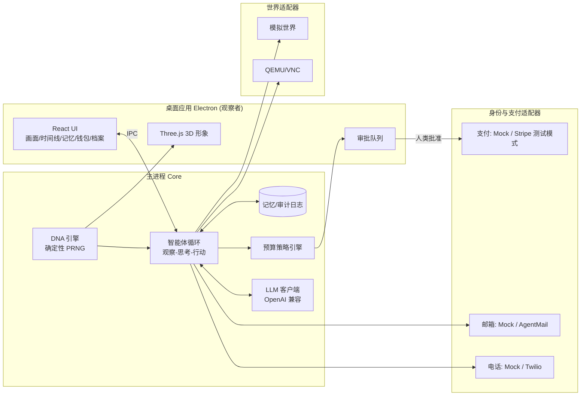

# Agent Life OS 设计文档（v0.3）

> 一个桌面软件：每个 AI 智能体"居住"在一台本地虚拟机（VM）里，把 VM 当作自己的"世界"，以模拟的虚拟人身份自主"生存与赚钱"；人类操作者在 VM 外部以**观察者**身份观看与干预。
>
> 调研日期：2026-10-12（北京时间）。文中所有外部事实均附来源链接；凡是来源未公开的信息（如价格），明确标注"未公开"，不做推测。

---

## 0. 核心原则（先读）

1. **法律主体永远是人类操作者。** 智能体不是法律主体，不能开户、不能签约、不能持有资产。本系统中所有支付账户、卡片、邮箱、电话号码、平台账号，**在法律上均登记在人类操作者（个人或公司）名下**，由操作者承担 KYC/KYB 义务与全部法律责任。智能体只是操作者授权的"代理工具"。
2. **"身份证"是虚构的世界内档案卡。** 系统生成的 "ID 卡" 是游戏化的角色档案（Agent Profile Card），**不模仿任何国家或地区的真实政府证件**（不使用国徽、真实证件版式、真实证件号码格式、防伪元素），卡面始终带有醒目的 "FICTIONAL · 虚构角色档案 · 非真实证件" 水印。禁止把它用于任何现实中的身份核验。
3. **花钱必须经人批准（默认）。** 默认所有支出需人工审批；人类可为小额、白名单商户设置自动批准阈值。
4. **只做合法且遵守平台条款的赚钱方式。** 不批量注册账号、不伪装成真人骗取信任、不绕过风控/验证码、不刷量。
5. **观察者模式默认只读。** 人类默认只看不碰；任何干预（暂停、接管、注入指令）都要显式切换并留审计记录。

---

## 1. 智能体支付方案调研

### 1.1 方案逐一说明

| 方案 | 是什么 | 当前状态（截至 2026-10） | 来源 |
|---|---|---|---|
| **Stripe Issuing / Issuing for agents** | 为每个智能体发行独立虚拟卡，支持单次卡、按智能体限额、商户类别（MCC）控制、实时授权 Webhook 逐笔批准/拒绝 | Issuing 本身正式可用；"Issuing for agents" 中"给自家业务发卡"在 Dashboard 申请，"平台型"需联系 Stripe；与 MPP/UCP 的程序化支付（Shared Payment Token）为**私有预览**（预览 API 版本 2026-04-22.preview） | [Issuing for agents](https://docs.stripe.com/issuing/agents)、[程序化结账](https://docs.stripe.com/issuing/agents/programmatic-checkout)、[Stripe 博客](https://stripe.com/blog/giving-agents-the-ability-to-pay) |
| **Stripe Agent Toolkit** | 把 Stripe API 以函数调用/MCP 形式暴露给 OpenAI Agents SDK、LangChain、CrewAI、Vercel AI SDK；**并不覆盖全部 Stripe API** | 开源可用（Python/TypeScript） | [github.com/stripe/agent-toolkit](https://github.com/stripe/agent-toolkit) |
| **Link 智能体钱包** | 基于 Issuing for agents，智能体可从用户 Link 钱包申请一次性卡或 SPT，拿不到原始卡号 | 已发布（面向用户钱包场景） | [Stripe 博客](https://stripe.com/blog/giving-agents-the-ability-to-pay) |
| **Visa Intelligent Commerce (VIC)** | 卡片令牌化 + "购买意图"API，智能体代用户下单；配套 Trusted Agent Protocol | 开发者文档标注为 **pilot（试点）**；Visa 可用性矩阵显示为有限试点；Agentic Ready 计划已在欧洲/英国、亚太（澳、港、日、马、新西兰、新、韩、台、泰、越）、拉美上线，但面向**发卡行/合作方**，需联系 Visa 客户经理 | [VIC 开发文档](https://developer.visaacceptance.com/docs/vas/en-us/intelligent-commerce/developer/all/rest/intelligent-commerce.html)、[可用性矩阵](https://developer.visa.com/availability)、[亚太新闻稿](https://www.visa.com.sg/about-visa/newsroom/press-releases/visa-launches-agentic-ready-program-in-asia-pacific-with-over-50-partners-advancing-agentic-commerce.html)、[全球扩展 2026-04-29](https://usa.visa.com/about-visa/newsroom/press-releases.releaseId.22341.html) |
| **Mastercard Agent Pay** | 每个智能体一个 "Agentic Token"，持卡人显式授权 + Payment Passkey 确认，智能体需先注册/验证 | 2025 年美国上线；2026 年在澳、新西兰、新加坡、马来西亚、印度、韩国、台湾、香港完成真实交易，泰国试点，拉美 2026 年推出。面向发卡行、收单方与合作平台，非个人开发者自助 | [香港首笔交易](https://newsroom.mastercard.com/news/ap/en-hk/newsroom/press-releases/en-hk/2026/mastercard-completes-its-first-live-agentic-transaction-in-hong-kong/)、[拉美](https://newsroom.mastercard.com/news/latin-america/en/newsroom/press-releases/pr-en/2025/december/mastercard-unveils-agent-pay-in-latin-america-and-the-caribbean/)、[亚太部署汇总](https://asiapacificexpress.com/mastercard-completes-south-koreas-first-live-authenticated-agentic-transaction-under-agent-pay-framework/) |
| **Coinbase AgentKit + x402** | AgentKit：给智能体加密钱包与链上操作；x402：基于 HTTP 402 的稳定币（USDC）按次付费协议，内置 `paid_request` 动作 | 开源可用；x402 仓库已迁至 x402 Foundation；使用 Coinbase facilitator 需 CDP API Key | [x402 介绍](https://www.coinbase.com/en-gb/developer-platform/discover/launches/x402)、[x402 仓库](http://github.com/coinbase/x402)、[AgentKit](https://github.com/coinbase/agentkit)、[CDP 文档](https://docs.cdp.coinbase.com/agentic-wallet/cli/skills/monetize-service) |
| **Privacy.com** | 面向个人/小企业的虚拟卡，可按卡设置单笔/月/年/总额限额 | 可用；仅限美国居民/公民（18+）及美国企业 | [价格](https://www.privacy.com/pricing)、[条款](https://www.privacy.com/terms)、[Privacy Pro](https://support.privacy.com/hc/en-us/articles/360039640953-What-is-Privacy-Pro) |
| **Lithic** | 发卡 API，支持虚拟卡、免费沙盒模拟交易 | 可用；商业账户需 KYB（实体、控制人、25% 以上受益所有人），外部银行账户须为美国账户 | [KYB](https://docs.lithic.com/docs/account-holders-kyb)、[外部账户](https://docs.lithic.com/docs/external-accounts-api)、[沙盒](https://docs.lithic.com/docs/enviornments) |
| **Skyfire (KYAPay)** | "Know Your Agent" 身份 + 支付令牌（JWT：kya / pay / kya-pay），卖方验证后扣款 | 可用；钱包可用 Base 链 USDC、借记/信用卡充值，付费订阅可用 ACH/电汇；KYC 验证为可选但需个人/组织订阅 | [充值](https://docs.skyfire.xyz/docs/wallet-funding)、[KYA](https://docs.skyfire.xyz/docs/kya)、[KYAPay 白皮书](https://kyapay.org/whitepaper) |
| **Payman AI** | 让智能体在用户授权、策略控制和审批下通过用户银行账户/钱包转账；SDK `@paymanai/connect` | 可用；结果状态含 `approval`（需用户批准） | [官网](https://paymanai.com/)、[Quickstart](https://paymanai.mintlify.app/quickstart) |

### 1.2 对比表

| 方案 | KYC/KYB（归属真人/公司） | 限额控制 | 地区（含中国） | 成本 |
|---|---|---|---|---|
| Stripe Issuing | 需公司 KYB，持卡人信息 | 每卡限额、MCC、实时授权、单次卡 | 本地发卡：美国及文档列出的英国、欧洲经济区、加拿大等 22 国（[来源](https://docs.stripe.com/issuing/global)）；美国企业只能给同国个人发卡；**中国大陆不在列表** | 虚拟卡 $0.10/张（美国），£0.10/€0.10（[来源](https://docs.stripe.com/issuing/cards/virtual)） |
| Visa VIC | 通过发卡行/收单方，用户卡需已持有并令牌化 | 由意图与令牌约束 | 试点；亚太名单不含中国大陆 | 未公开 |
| Mastercard Agent Pay | 持卡人授权 + 智能体注册 | 令牌级控制 + Passkey | 9+ 市场，含香港，不含中国大陆 | 未公开 |
| Coinbase x402/AgentKit | 协议本身无 KYC；CDP/法币出入金需 Coinbase 账户与 KYC | 自定义（钱包策略） | 技术全球可用；**中国大陆法律禁止**（见 1.3） | Base 链手续费约 1 美分级别（Coinbase 自述，[来源](https://www.coinbase.com/en-gb/developer-platform/discover/launches/x402)） |
| Privacy.com | 美国个人 KYC / 美国企业 | 单笔/月/年/总额 | 仅美国 | 免费版每月 12 张新卡；Pro $10/月 36 张、含 API（[来源](https://www.privacy.com/pricing)） |
| Lithic | 美国企业 KYB | 每卡限额、授权流 | 美国 | 沙盒免费；生产价格官方未公开 |
| Skyfire | 可选 KYC/KYA（需订阅） | 令牌金额上限 | 未公开地区清单 | 订阅与费率未公开 |
| Payman | 用户连接自己的银行账户/钱包 | 策略 + 审批 | 未公开 | 未公开 |

### 1.3 中国大陆用户的特别说明

- **加密货币路线（x402 / AgentKit / Skyfire USDC 充值）在中国大陆风险极高**：2026-02-06 发布的《关于进一步防范和处置虚拟货币等相关风险的通知》（银发〔2026〕42号，取代 2021 年"924通知"）明确虚拟货币（点名泰达币等稳定币）不具法偿性，境内兑换、交易、中介等业务属非法金融活动，境外主体不得向境内提供相关服务。来源：[中国人民银行](https://www.pbc.gov.cn/tiaofasi/144941/3581332/2026020619591971323/index.html)、[证监会转载](https://www.csrc.gov.cn/c100028/c7614318/content.shtml)、[君合解读](https://www.junhe.com/legal-updates/2910?locale=zh)。**本系统在中国大陆部署时默认关闭加密支付适配器。**
- 美国系发卡服务（Stripe Issuing、Privacy、Lithic）均要求美/欧等地的实体或居民，中国大陆个人无法直接申请。可行路径：(a) 操作者在支持地区合法设立的公司申请；(b) 仅使用沙盒/测试模式做研发；(c) 由操作者本人的境内合规支付工具人工付款（智能体只发起"付款申请"，人去付）。
- 不建议使用来路不明的"虚拟卡代开"服务，存在资金安全与合规风险。

### 1.4 推荐策略

- **MVP**：Stripe Issuing **测试模式**（免费）+ 本地模拟钱包；所有支出走人工审批。
- **生产（海外实体）**：Stripe Issuing for agents，每个智能体 1 张虚拟卡 + 实时授权 Webhook 接入本地审批队列；可选 Privacy.com（美国个人）。
- **观察项**：Visa VIC、Mastercard Agent Pay 目前面向发卡行/大型合作方，待开放自助开发者接入后再接。

---

## 2. 身份层

### 2.1 邮箱

| 方案 | 说明 | 成本 | 来源 |
|---|---|---|---|
| AgentMail | 为 AI 智能体设计的 API 邮箱，程序化创建收件箱、收发、线程、Webhook | 免费 3 个收件箱/3000 封每月；Developer $20/月 10 个；Startup $200/月 150 个 | [文档](https://www.agentmail.to/docs/inboxes)、[价格](https://www.agentmail.to/pricing) |
| Google Workspace | 自有域名下给每个智能体一个账号（操作者为管理员），需遵守 Google 条款 | 按席位收费 | — |
| 自建（Postfix/Dovecot、Stalwart 等） | 自有域名，完全可控；投递率需配 SPF/DKIM/DMARC | 服务器成本 | — |

推荐：MVP 用 AgentMail（免费档足够 3 个智能体），并在邮件签名中声明"本邮件由 AI 助理代 XXX（操作者）发送"。

### 2.2 电话

- **Twilio**：美国本地号码约 $1.15/月起，免费电话号码约 $2.15/月起；A2P 10DLC 短信需额外注册费用（[来源](https://www.twilio.com/en-us/phone-numbers)）。Twilio **不提供 +86 中国号码**，中国短信仅支持单向下行、无双向短信（[短信指南](https://www.twilio.com/en-us/guidelines/cn/sms)、[语音指南](https://www.twilio.com/en-us/guidelines/cn/voice)）。
- **中国大陆实名制**：依据工信部《电话用户真实身份信息登记规定》，办理入网必须查验有效证件并登记真实身份，身份不明不得办理（[中国政府网](https://www.gov.cn/zhengce/2022-08/23/content_5722716.htm)）；物联网卡等行业卡同样实名、禁止二次销售，涉诈高风险卡需二次实人核验（[通告](https://gat.zj.gov.cn/art/2021/9/2/art_1229559119_2348968.html)）。因此**不得为智能体购买/使用他人身份或"黑卡"**；中国号码只能是操作者本人或其公司实名办理的号码。
- 推荐：MVP 只用模拟电话（本地收件箱）；需要真实号码时，用操作者名下的 Twilio 美国号码接收验证码/通知。

### 2.3 虚构档案卡（"ID 卡"）规范

- 名称：**Agent Profile Card / 世界内角色档案卡**。
- 版式：自定义科幻风格，不得模仿身份证、护照、驾照；编号格式为 `ALOS-XXXX-XXXX`（明显非真实证件号）。
- 必含字段：角色名、DNA 指纹、生成日期、性格标签、所属"世界"（VM 名称）、**法律责任人：<操作者姓名/公司>**。
- 水印："FICTIONAL · 虚构角色档案 · 非真实证件 · NOT A GOVERNMENT ID"。
- 声明：**该智能体名下的所有账户、支付工具与收益在法律上归人类操作者所有。**

---

## 3. DNA / 性格种子

### 3.1 Schema（JSON）

```json
{
  "$schema": "https://agent-life-os.local/dna.schema.json",
  "version": 1,
  "seed": "a3f9c2e1-...",          
  "name_hint": null,
  "genome": {
    "openness": 0.72, "conscientiousness": 0.55, "extraversion": 0.31,
    "agreeableness": 0.66, "neuroticism": 0.24,
    "risk_tolerance": 0.4, "frugality": 0.7, "curiosity": 0.8
  },
  "origin": { "city_archetype": "harbor-metropolis", "birth_year": 1998, "family": "single-parent" },
  "skills": ["writing", "illustration", "python"],
  "values": ["autonomy", "craft"],
  "appearance": {
    "body_height": 0.52, "body_build": 0.4, "skin_hue": 0.08, "hair_style": 3,
    "hair_hue": 0.62, "eye_hue": 0.55, "accent_color": "#00f0ff", "outfit": "techwear"
  },
  "economy": { "start_budget_usd": 20, "daily_spend_cap_usd": 5, "auto_approve_below_usd": 0 }
}
```

### 3.2 确定性生成

- 以 `seed` 初始化可复现 PRNG（如 mulberry32 + 字符串哈希）；同一 seed 永远得到相同的 genome/appearance/姓名/履历骨架。
- **人生故事**：先由 PRNG 生成结构化事件骨架（出生、教育、转折、目标），再交给 LLM（温度 0、带 seed 参数）润色为叙事文本；无 LLM 时用模板拼接，保证离线可用。
- **3D 外观**：appearance 参数驱动生成。

### 3.3 3D 外观方案

| 方案 | 现状 | 来源 |
|---|---|---|
| Ready Player Me | **公共开发者 API 已于 2026-01-31 关闭**，不再推荐 | [迁移指南](https://avatarsdk.com/blog/2026/07/07/ready-player-me-migration-guide/) |
| Avatar SDK / MetaPerson | 自拍生成 3D，GLB/glTF 导出，支持 Web | [MetaPerson](https://avatarsdk.com/ready-player-me-alternative/) |
| Avaturn | API/Web SDK 需付费套餐 | — |
| VRoid Studio | 手工捏人导出 VRM，可用 three-vrm 在 Three.js 渲染 | — |
| Meshy | 文生 3D 20–30 credits，自动绑骨 5 credits；Pro $20/月 1000 credits 含 API | [价格](https://docs.meshy.ai/api/pricing.md)、[绑骨 API](https://docs.meshy.ai/en/api/rigging) |
| Tripo | 自动绑骨 25 credits | [价格](https://docs.tripo3d.ai/get-started/pricing.html) |
| **程序化 Three.js（MVP 采用）** | 零成本、离线、完全由 DNA 决定 | — |

MVP：Three.js 程序化"全息人像"（身体比例/肤色/发型/配色来自 DNA）；v2：用 DNA 生成 prompt 调 Meshy/Tripo 生成 GLB 并缓存。

---

## 4. 系统架构

### 4.1 VM 控制

- **虚拟化**：QEMU/KVM（Linux）、UTM（macOS，基于 QEMU）、VirtualBox（跨平台）。统一抽象为 `WorldAdapter` 接口：`screenshot()`、`click(x,y)`、`type(text)`、`key(combo)`、`scroll()`。
- **画面通道**：QEMU 内建 VNC + WebSocket（`-vnc :1,websocket=5701`），noVNC 在应用内显示（注意 QEMU 的 WebSocket 路径为 `/`）（[noVNC](https://github.com/novnc/noVNC)、[QEMU VNC](https://www.qemu.org/docs/master/tools/qemu-vnc.html)）。
- **智能体循环**：截图 → 多模态 LLM（OpenAI 兼容接口；或 OpenAI Responses `computer` 工具 / Anthropic computer-use 工具，[OpenAI](https://developers.openai.com/api/docs/guides/tools-computer-use)、[Anthropic](https://docs.claude.com/en/docs/agents-and-tools/tool-use/computer-use-tool)）→ 动作 JSON → 执行 → 记录 → 循环。每步写入时间线。
- **模拟世界模式**：无 VM 时用内置 2D 模拟桌面（浏览器/邮件/任务板/钱包），开箱即用。

### 4.2 桌面壳

选 **Electron + React + Three.js**（生态成熟、Node 可直接起子进程控制 QEMU）；Tauri 体积小，可作为 v2 迁移目标。

### 4.3 记忆

- 短期：最近 N 步动作与观察。
- 长期：SQLite/JSON 存储"事件—反思"条目，周期性总结（每日日记）；可选向量检索。
- 生活状态：能量、心情、存款、目标、技能经验值。

### 4.4 预算与审批

- 每智能体：日/周预算、单笔上限、商户白名单、自动批准阈值（默认 0 = 全部人工批准）。
- 支付流程：智能体 `request_payment` → 策略引擎 → 审批队列（观察者界面弹卡）→ 人类批准 → 支付适配器（Stripe 测试模式/模拟）执行。真实卡的情况下还应接入 Stripe 实时授权 Webhook 做二次把关。
- 全部操作写入只追加的审计日志。

### 4.5 合法赚钱方式与 ToS 风险

| 模式 | 说明 | 主要风险 |
|---|---|---|
| 自由职业（Upwork 等） | 写作、翻译、编程 | Upwork 要求一人一账号、真实身份，未授权自动化/机器人会被封号；AI 智能体只能通过受邀的 MCP/API Beta，提交提案等需用户确认，智能体不能动钱（[服务条款](https://www.upwork.com/legal-notice/)、[自动化政策](https://support.upwork.com/hc/en-us/articles/43342677368467-Use-bots-and-other-automation-properly)）→ 账号必须是操作者本人的，智能体起草、人类提交 |
| 内容创作 | 博客、图文、插画、短视频脚本 | 平台 AI 内容标注要求、版权 |
| 数字产品 | 模板、提示词包、小工具 | 支付平台对卖家 KYC |
| 付费 API（x402） | 智能体提供按次收费服务 | 中国大陆禁止（见 1.3） |

禁止：批量注册、刷单刷量、绕过验证码、冒充真人骗取信任、薅羊毛。

---

## 5. 观察者模式（Observer Mode）

VM 是虚拟人的"世界"，人类在外部观察。**默认只读**。

| 面板 | 内容 |
|---|---|
| 实时画面 | VM 屏幕流（noVNC / 模拟世界画布），叠加智能体当前光标与动作高亮 |
| 时间线 | 每一步的"思考 → 动作 → 结果"，可回放、可筛选 |
| 记忆/生活状态 | 短期记忆、长期日记、能量/心情/目标 |
| 收支看板 | 余额、收入/支出流水、预算消耗、待审批请求 |
| 档案 | DNA、人生故事、虚构档案卡、3D 形象 |
| 控制 | 暂停/继续、单步、**接管**（解锁后才能输入）、注入指令、批准/拒绝支出 |

所有干预动作写审计日志并在时间线中以"人类干预"标记。

---

## 6. 架构图



---

## 7. 分阶段 MVP 路线图

| 阶段 | 目标 | 交付 |
|---|---|---|
| P0（第 1–2 周） | 原型 | Electron 观察者 UI、DNA→人格/档案卡/3D、模拟世界、Mock 支付/邮箱/电话、人工审批、OpenAI 兼容 LLM（无 Key 时用规则策略） |
| P1（第 3–5 周） | 真实 VM | QEMU 适配器（VNC 截图+输入）、noVNC 画面、computer-use 动作模型、SQLite 记忆 |
| P2（第 6–8 周） | 真实身份（操作者名下） | AgentMail 收件箱、Twilio 美国号码、Stripe Issuing 测试→生产，实时授权 Webhook |
| P3（第 9–12 周） | 赚钱闭环 | 内容创作与人类确认的自由职业工作流、收益记账、日报 |
| P4 | 扩展 | 多智能体、Meshy/Tripo 3D、Tauri 迁移、VIC/Agent Pay 接入（待开放） |

---

## 8. 风险清单

- 法律：账户归属、税务（收入属于操作者）、中国大陆加密货币禁令、电话实名制。
- 平台：多账号、自动化条款。
- 安全：VM 隔离、密钥只放主进程、网络出口白名单、支出硬上限。
- 伦理：对外交流中披露 AI 身份。

---

## 9. 原型实现（v0.2，已随本文档交付）

同目录下的 Electron + React + Three.js 原型实现了 P0 及部分 P2：

- DNA → 人格 / 虚构档案卡 / 程序化 3D 形象；模拟世界开箱即用；规则 / OpenAI 兼容 LLM 双大脑。
- 观察者模式：实时画面、思考/动作时间线、记忆与生活状态、收支看板；默认只读，开启 **God Mode** 后才能暂停、单步、接管、注入指令、分叉/删除世界。
- 预算策略与人工审批（只读模式下也能审批，因为审批是守护职责而不是干预）。
- mock 与真实适配器（Stripe 测试模式 / AgentMail / Twilio / QEMU，真实适配器均未实测）。
- 平行世界（第 11 节）与世界终极公式（第 10 节），引擎每一步都校验。
- 专业桌面 UI：深色、单一强调色、Inter + 中文回退字体、lucide 矢量图标（界面零 emoji，有测试守护）、framer-motion 动效（遵守系统"减少动态效果"设置）、首次启动引导。

运行方式见 `README.md`，三轮评审报告见 `docs/reviews/`。

---

## 10. 世界终极公式

每个世界都是一个确定性的离散时间系统。所有模块（世界、大脑、钱包、策略、记忆、平行世界、界面）只能通过下面这一个转移函数改变世界：

```
S(t+1) = F( S(t), a(t), h(t) ; R, σ )
```

| 符号 | 含义 | 代码位置 |
|---|---|---|
| `S(t)` | 第 t 步的完整世界状态：时间、能量、心情、应用状态、任务/订单、钱包流水、预算计数、记忆、RNG 计数 | `engine.exportState()` |
| `a(t)` | 智能体动作（规则大脑或 LLM 给出的一次点击/输入/等待） | `brain.decide()` → `engine.execute()` |
| `h(t)` | 人类输入：审批/拒绝、注入指令、接管时的点击。只有 God Mode 才能产生除审批以外的 h(t) | `electron/main.js` IPC |
| `R` | 规则：预算策略（单笔/每日上限、自动批准阈值）、世界规则（熵、价格） | `core/policy.js`、`core/world/simWorld.js` |
| `σ` | 种子：DNA 种子 + 分支种子。世界里所有随机都来自 σ 派生的计数 PRNG | `core/prng.js` |

七条定律（`core/formula.js` 的 `checkInvariants()` 在每一步之后校验；违反会写入时间线"违反定律"并计入 `violations`，测试要求为 0）：

1. **L1 货币守恒**：余额 ≡ Σ 流水；每次余额变化恰好对应一条流水，不存在凭空出现或消失的钱。
2. **L2 货币边界**：钱只能经 `fund`（操作者注资）或 `earn`（交付工作后外部客户付款，金额必须为正）流入，只能经 `spend` 流出；每一笔 `spend` 都必须带 `approval`（`auto` 或人工审批 id），未批准前不扣款；余额永不为负。
3. **L3 因果律**：事件序号单调递增，果不先于因；每个结果事件、每一笔收支事件都必须带 `cause`（指向触发它的动作或审批事件 id）。
4. **L4 时间之箭**：世界时间单调不减，每个动作消耗 Δt > 0；快照只能向前重放，不能修改过去。
5. **L5 熵与需求**：能量随时间衰减（每小时 2 点，休息除外），工作额外消耗；能量 ∈ [0, 100]，心情 ∈ [0, 1]；只有休息、咖啡等动作能补充。
6. **L6 可复现**：给定 (σ, 规则大脑, h 序列)，轨迹完全可复现——事件 id、邮件 id、支付流水号都由计数器生成，不依赖系统时间；LLM 大脑被记录为非确定性来源。
7. **L7 分支隔离**：平行世界之间不共享任何可变状态；一个世界的审批、扣款、记忆不会影响另一个世界。新创世时上一轮人生的长期记忆会归档，不混入本轮。

测试覆盖：`test/headless.test.js`（L1–L5，80 步零违反、审批前不扣款）、`test/multiverse.test.js`（L6 两次独立运行一致、快照重放一致；L7 分支并发、隔离、审批路由）。

---

## 11. 平行世界（Multiverse）

- **分叉**：任意世界每 5 步自动打快照（最多保留 40 个，创世快照永久保留）。在 God Mode 下可从任意快照分叉，分叉时可改变分支种子、性格基因（节俭、冒险）和预算策略（每日预算、自动批准阈值）。
- **并发**：每个世界是独立的 `AgentEngine`，有自己的计时器，在同一事件循环中并发运行；最多 8 个世界。
- **不合并（merge-free）**：分支之间只能对比，不能合并，保证 L7。
- **界面**：分支图（泳道 + 分叉曲线 + 快照刻度 + 运行中脉冲节点）、世界列表（切换/删除）、并排对比（生活状态、钱包、余额曲线、基因差异、时间线共同历史与分歧）。标题栏的世界切换器可随时切换"正在观察"的世界。
- **审批**：所有世界的待审批支出汇总在一个队列里，审批 id 带世界前缀，只扣对应世界的钱。
- **删除**：删除某个世界时其子分支会重新挂到它的父世界；主世界不可删除。

---

## 12. 世界维度体系（v0.3）

### 12.1 设计思路

题目给的例子（人终有一死、遗传、高级文明）只是起点。作为世界设计者，我们要回答的是：“一个值得长期观察的虚拟人生，必须在哪些层面上是真的？”我们的答案是 8 个维度、41 个子维度。每个子维度都写明四件事：

1. **状态**：写进 S(t) 的变量；
2. **规则**：在 F 中如何演化；
3. **定律**：哪条可检查的不变量约束它；
4. **配置**：God Mode 能调的规则参数（属于 R，不属于 S）。

代码见 `core/life/dimensions.js`，“文明与环境 → 维度体系”页面会逐条展示。

| 维度 | 子维度 |
|---|---|
| 生命 | 出生、衰老、健康、疾病、死亡、需求层级 |
| 遗传 | 双亲遗传、突变、性状表达、自然选择与演化 |
| 心智 | 情绪、记忆衰减、学习、人格漂移、信念、意识与意义 |
| 社会 | 家庭与家谱、伴侣关系、繁衍、声望、合作与冲突、群体 |
| 经济 | 劳动、稀缺、交易、通胀、财富继承 |
| 文明 | 科技树、文化、语言、制度与法律、卡尔达肖夫等级、兴衰 |
| 环境与生态 | 资源、气候、其他物种与食物链、灾害、熵 |
| 时间与命运 | 随机与因果、世代、时间尺度 |

### 12.2 对终极公式的扩展

公式仍是 S(t+1) = F(S(t), a(t), h(t); R, σ)，只是 S 新增了一个“社会层”：人口、家谱、基因、粮币经济、文明和环境。

- **时间压缩**：Δ年 = Δ世界分钟 / 1440 × `yearsPerDay`，默认每个世界日 4 年。社会层按 ≤0.25 年的子步推进。
- **主角**：智能体就是主角，主角也会死。
  - 主角死后，按顺序找继承人：长子女 → 孙辈 → 兄弟姐妹 → 血脉中年满 12 岁者。
  - 都没有时，若制度水平 ≥ 0.3，可以收养。
  - 仍然没有，就“血脉断绝”，智能体循环停止，世界进入观察终局。
  - 账户与资金始终归人类操作者所有，继承只改变“虚拟人生”中由谁代入。
- **两种货币（PM 决策）**：
  - 智能体的美元钱包仍由 L1/L2 和审批流程管理。
  - 社会内部使用独立的“粮币”，不会与真实资金混淆。
- **主要模型**：
  - 死亡：Gompertz 风险 h = 0.0004·e^(0.085·age)，再乘以体质选择、科技和地点修正。
  - 遗传：二倍体等位基因；表型 = 均值 + 漂移（|漂移| ≤ 0.2）；突变服从高斯分布并全部记录。
  - 生态：Lotka–Volterra 捕食模型。
  - 资源：可再生资源 logistic 增长；不可再生资源只消耗。
  - 气候：由累计排放驱动的温度异常。
  - 灾害与疫病：泊松过程。
  - 文明等级：卡尔达肖夫（Sagan 插值）K = (log10 P − 6) / 10。
  - 科技：19 项科技，含前置依赖；长期不稳定会导致崩溃并失传。

### 12.3 新增定律（每一步都检查，违反写入时间线）

| 编号 | 名称 | 内容 |
|---|---|---|
| L8 | 必死律 | 没有人能活过寿命上限。每个死者都有死因和死亡时间，且死亡时间不早于出生。死者不能复活。 |
| L9 | 遗传守恒 | 子代每条等位基因都来自对应亲本，突变除外，且突变必须被记录。人格漂移只改变表型，不改变基因。 |
| L10 | 财富守恒与继承 | Σ在世者财富 + 公库 = 累计创造 − 累计消耗。死者财富为 0，遗产分配前后总额不变。 |
| L11 | 熵增 | 世界总熵永不减少。 |
| L12 | 资源有限 | 资源 ∈ [0, 容量]。不可再生资源只减不增。物种数量不为负。 |
| L13 | 人口守恒 | 在世人口 = 始祖 + 累计出生 − 累计死亡。 |
| L14 | 世代因果 | 新生儿恰有两位在世亲本，母亲处于 14–50 岁。子代代数 = 亲本最大代数 + 1。 |
| L15 | 文明有界 | 已解锁科技的前置必须全部解锁。卡尔达肖夫等级只能由能耗按公式算出。 |
| L16 | 心智有界 | 健康、需求、情绪、意义感 ∈ [0,1]，心情 ∈ [−1,1]。记忆强度只衰减。 |

### 12.4 God Mode

**法则参数**（属于 R，从下一步起生效，不改写历史）：

| 参数 | 范围 |
|---|---|
| 时间压缩 | 0.5–120 年/日 |
| 寿命上限 | 60–150 |
| 生育率 | 0–0.5 |
| 突变率 | 0–0.2 |
| 选择强度 | 0–1 |
| 疫病率 | 0–0.3 |
| 灾害率 | 0–0.2 |
| 研究速度 | 0–3 |
| 气候敏感度 | 0–3 |
| 资源再生率 | 0–0.2 |

- **天启**（属于 h(t)，同样必须守律）：瘟疫、天灾、风调雨顺、灵感、调停。
- “复活死者”按钮是禁用状态，并注明“被 L8 必死律禁止”。引擎层面会直接拒绝这个操作。
- 平行世界分叉时可以单独设定疫病率、突变率和灾害率，从而做“同一个人、不同法则”的对照实验。

### 12.5 观察者界面

- **生命与家族**：
  - 纪元年、在世人口、世代、累计突变；
  - 主角的人生阶段条（婴儿 → 老年，带动画指示）；
  - 健康、意义感、技能、教育；
  - 马斯洛需求金字塔、情绪；
  - 家谱：按代分行；已故者虚线；带突变者有标记；悬停显示死因；
  - 等位基因面板（父源/母源）、世代时间线、死因分布、家族大事。
- **文明与环境**：
  - 卡尔达肖夫仪表（标出地球今日约 0.73，依据 Sagan 插值和约 2×10¹³ W 的人类能耗量级）；
  - 科技树、文化与制度、粮币经济、信念与家族；
  - 环境与生态曲线；
  - 维度体系页与世界法则页。
- **平行世界对比**：新增“生命与文明”表格，比较纪元、人口、世代、主角、更替次数、出生/死亡、主要死因、时代、K、科技、稳定度、气候、基尼系数、天气和法则，差异行会高亮。另附人口走势对比图。
- **记忆**：长期记忆按艾宾浩斯强度淡出，强度低于 50% 时标注“渐淡”。

### 12.6 测试（`test/life.test.js`）

- **人终有一死**：始祖全部去世，每个死者都有死因；寿命上限 70 岁时无人超过。
- **遗传**：抽查 362 个个体，基因全部来自父母；突变率 0.1 时实测 0.102，且全部被记录。
- **多世代守律**：500 年、21 代，定律违反为 0。
- **自然选择**：选择组的体质均值从 0.53 升到 0.76，无选择对照组为 0.34。
- **可复现与恢复**：同种子结果一致；快照恢复后继续运行，与原轨迹一致。
- **文明**：科技树前置自洽；崩溃后仍自洽。
- **天启**：复活被拒绝；其余天启之后仍零违反。
- **引擎集成**：657 年、24 代，零违反。
- **平行世界**：“瘟疫世界”与主世界出现分歧，两边都零违反。

## 13. 镜像世界（数字孪生，v0.3）

### 13.1 目标

让观察者看到一个“真实地点”的 3D 世界：从地球缩放到街区，看到智能体与家人在真实建筑之间上班、购物、回家。昼夜和天气由世界时间与气候决定。

### 13.2 数据源（全部开放、离线可运行、无需密钥）

| 数据 | 来源 | 许可 | 用法 |
|---|---|---|---|
| 街区建筑、道路、公园、水体、POI | OpenStreetMap，经 Overpass API 于 2026-10-12 抓取并随包打包（`src/assets/geo/osm-lujiazui.json`，上海陆家嘴，151 栋建筑、614 条道路、85 个 POI） | ODbL 1.0，界面常驻署名 | 拉伸建筑（使用真实高度，如上海中心 632 m）、映射地点 |
| 地球陆地轮廓 | Natural Earth 1:110m land | 公有领域 | 程序生成地球的昼/夜贴图与城市灯光 |
| 高程 | 未使用 | — | 陆家嘴地势平坦，开放高程数据对这一街区没有可见收益。需要山地锚点时，可以接入 Open-Elevation 或 Copernicus DEM（尚未实现） |

可选（需要使用者自己的密钥，未在本环境验证）：

- `ALOS_GOOGLE_TILES_KEY`：Google Photorealistic 3D Tiles。
- `ALOS_CESIUM_ION_TOKEN`（以及可选的 `ALOS_CESIUM_ASSET_ID`，默认 96188 OSM Buildings）：Cesium ion。

两者都通过 `3d-tiles-renderer` 动态加载。没有密钥时，“真实感 3D 瓦片”开关保持禁用，并提示如何开启。

可选在线抓取：设置 `ALOS_MIRROR_CENTER=lat,lon` 后，启动时会从 Overpass（主站，失败后改用镜像站）抓取约 1.1 km 见方的街区并缓存。本次实测公共 Overpass 返回过 406/504，抓取失败时自动回退到随包数据。

### 13.3 实现

- **地球**：着色器混合昼面和夜面，晨昏线由世界时间推出的太阳直射点决定；另有云层、菲涅尔大气、星空和锚点脉冲。
- **街区**：
  - OSM 建筑拉伸，窗灯随夜晚亮起；
  - 道路、公园和水体；
  - 半球光、太阳（高度角和方位角按纬度、赤纬、时角计算）和月光；
  - 软阴影、指数雾；
  - 雨、雪、云和闪电。
- **天气**：由 (种子 + 分支种子, 日, 时, 气候异常, 季节) 确定性推出，不消耗世界随机数，所以不会破坏 L6 可复现。
- **地图与地点**：
  - 地点映射到真实 OSM 建筑或 POI（住宅、写字楼、商店餐饮、公园、文化中心）。
  - 街区内缺少的类型（医院、学校、农场）以“镜像补全”的虚拟地点补齐，并明确标注。
  - 地点会影响规则，例如医院降低死亡风险。
- **居民**：按小时和年龄作息（睡觉、上班、上学、购物、散步、就医），在地点之间行走。主角带世界颜色光环。
- **交互**：
  - 地球 / 街区切换，带飞行和渐隐过渡；滚轮缩放到阈值也会自动切换。
  - 点击居民或地点打开检查面板，并让相机飞过去。
  - 地点面板列出此刻在场的人；可以从居民跳到家谱。
- **God Mode**：在地图上新建（选类型后点击地面）、改名、移动和拆除地点（至少保留一处住宅和一处工作地点）。这些属于 h(t)，同样必须守律。
- **平行世界**：地点、居民、天气和时间都是每个世界独立的状态，分叉时一并复制。
- **自适应画质**：前 3 秒帧率低于 24 时，自动关闭阴影并降低像素比。
- **reduced-motion**：开启“减少动态效果”时，相机飞行瞬间完成，雨雪静止。

### 13.4 已知限制

- 只打包了一个锚点街区。其他城市需要联网抓取，或自行准备 JSON。
- 居民走直线，不沿道路寻路。
- 3D Tiles 路径没有密钥可测。
- 本环境是软件渲染（xvfb 下约 5–10 fps），真实 GPU 上会流畅得多。

## 14. 智能体桌面：第一人称操作一台本地电脑（v0.4）

### 14.1 目标
v0.3 的反馈是：用户看不到虚拟人自己的视角，看不到 TA 操作电脑。v0.4 新增「智能体桌面」页面。人类守护者把一台**本地电脑**指定给某个智能体，智能体按生命需求自动操作这台电脑，比如饿了自己点外卖、钱少了去接零工。观察者在大屏上实时看光标、点击和键入，也能随时暂停、单步、接管或回放录像。

### 14.2 绑定目标（按智能体分别绑定）
| 目标 | 说明 | 状态 |
|---|---|---|
| 内置沙盒桌面 | 在应用内渲染的模拟操作系统：顶栏、桌面图标、程序坞、窗口管理（层级、遮挡、最小化、关闭）、浏览器（地址栏、后退、刷新），以及模拟网站：速达外卖 `waimai.sandbox`、优选商城 `shop.sandbox`、灵活工作 `jobs.sandbox`、邮箱 `mail.sandbox`，外加记事本。离线可用，不需要任何配置。 | 可用（默认） |
| VNC 电脑 | 自研最小 RFB 客户端：协议 3.3、3.7、3.8；认证支持“无”和标准 VNC 密码（纯 JS DES，因为 Node 的 OpenSSL 3 已移除 des-ecb）；编码支持 Raw、CopyRect、DesktopSize；可截图为 PNG，注入鼠标、滚轮和 X11 keysym 键盘事件。 | 已对 Xvfb + x11vnc + Chrome 实测 |

- **连接测试**：在界面上输入主机、端口和密码后点「测试连接」，会返回服务器名、分辨率、RFB 版本、认证方式、延迟和首帧预览。密码错误时提示“认证失败”。
- **按智能体绑定**：绑定关系写入 `<数据目录>/desktop-targets.json`，键为 DNA 指纹。VNC 密码用系统钥匙串加密（Electron safeStorage）；钥匙串不可用时，密码只保存在本次运行的内存里，不写入明文。
- **默认值**：应用默认绑定内置沙盒。`ALOS_DESKTOP=off` 时不绑定，回到经典任务板世界。
- **平行世界**：沙盒的状态（窗口、购物车、订单、计数随机数）随快照序列化，可以分叉。一台真实 VNC 电脑无法分叉，分叉出的世界会改用内置沙盒。
- 没有嵌入 noVNC：画面由主进程的 RFB 客户端解码，以约 250 ms 的节流推送 PNG 帧到界面（IPC `alos:frame`）。这样不需要 websockify，也没有浏览器端 ESM 兼容问题。

### 14.3 Computer-use 循环
每一步：**观察 → 决策 → 动作 → 校验**。

1. **观察**
   - 沙盒：屏幕解析，相当于 OCR 加控件检测。它得到可见的文字、角色和像素矩形，并做窗口遮挡剔除，被上层窗口挡住的控件看不到。同时也有可渲染的显示列表。
   - VNC：真实截图，PNG 格式，宽度上限 `ALOS_CUA_SHOT_WIDTH`，默认 1280。
2. **决策**
   - 已配置 OpenAI 兼容视觉模型（`OPENAI_BASE_URL`、`OPENAI_MODEL`、`OPENAI_API_KEY`；`OPENAI_VISION=0` 时只发文字）：把目标、计划、身体与钱包状态、最近动作和截图（或屏幕元素列表）交给模型，模型每步输出一个 JSON 动作。
   - 没有模型时，沙盒使用**规则回退**。它只读屏幕上的文字和矩形，按坐标点击，不使用任何内部 id，和真实电脑的约束一致。
   - VNC 没有模型时不会乱点。智能体会说明自己看不懂截图，然后等待，守护者可以接管。
3. **动作**：`move`、`click`、`double_click`、`type`、`key`（如 `Enter`、`ctrl+l`、`BackSpace`）、`scroll`、`wait`，另有 `rest`、`request_payment`、`done`。全部是屏幕坐标级的键鼠动作。
4. **校验**：沙盒对每个动作都有预期，例如“地址栏已聚焦”“已进入店铺页”。VNC 比较动作前后屏幕的签名。连续 6 次没有达到预期，就放弃当前目标。

### 14.4 目标来自生命需求，并接入世界定律
- 新增身体状态**饥饿**（0 到 1），每小时上升 0.05。饥饿 ≥ 0.85 时能量加速流失；饥饿到 1 时心情下降。主角的生理需求等于 1 − 饥饿。
- 目标优先级：
  1. 有进行中的订单：等它送达，然后吃饭。
  2. 能量 < 22：离开电脑休息。
  3. 饥饿 ≥ 60%：钱和今日预算都够，就点外卖；不够，就“先赚钱再吃饭”。
  4. 余额 < $12：接零工。
  5. 大约每 40 步：写一次日记。
  6. 其他时候：接零工。
- **点外卖流程**：打开浏览器 → 输入 `waimai.sandbox` → 按性格挑餐厅（开放性高的换着吃，否则吃评分最高的）→ 在预算内选主食，饿得厉害再加一份 → 去结算 → 提交订单，这一步只发起支付请求 → 走引擎的预算策略和**人工审批** → 批准后扣款，订单进入配送 → 按世界时间送达 → 点「确认收货」吃饭，饥饿下降。
  - 守护者拒绝：订单取消，不扣款。
  - 预算策略拒绝（例如超过单笔上限）：订单标记为被拒，不进入审批队列，也不扣款。
- **新定律**（每一步检查）：
  - **L17 代谢律**：饥饿 ∈ [0, 1]；只有进食事件能让它下降；每次吃外卖都对应一笔流水凭证一致的已支付订单。
  - **L18 人机边界**：智能体只能使用上面列出的键鼠动作；电脑里每笔已支付、已送达或已用餐的订单（以及商城购买），都有一笔经过策略和审批、备注含订单号的支出流水；未支付的订单没有扣款；接管期间智能体不得动作。

### 14.5 观察者界面（侧边栏「智能体桌面」）
- **绑定栏**：列出目标（内置沙盒 + 你添加的 VNC 电脑）及其状态，可以测试连接、绑定、解绑、删除，也可以添加 VNC 电脑（对话框里能先测试再保存）。
- **大屏直播**：沙盒直接渲染智能体做命中测试用的同一份显示列表，你看到的就是 TA 操作的像素。叠加效果：光标弹簧动画加轨迹、点击涟漪、键入与按键浮层、输入框打字机效果。VNC 显示实时帧，鼠标位置用光标叠加层表示。
- **控制**：暂停、继续、单步、接管。接管后，你在大屏上的点击、滚轮和键盘输入会直接发送到这台电脑，写入时间线和审计日志，智能体暂停。这些控制需要先开启 God Mode。
- **侧栏**：当前目标与原因、计划步骤（完成、进行中、待办）、身体与钱包（饥饿、能量、今日预算、余额）、思维流。
- **下方**：动作日志（含校验结果）、外卖订单状态、录像列表。每完成或放弃一个目标，就自动保存一段录像（逐步画面、动作、想法），保存在 `<数据目录>/<指纹>/<世界>/recordings/*.json`，可以播放、逐步查看或拖动进度。
- 新手引导新增第 4 步介绍本页；「世界画面」页在电脑已绑定时提示去「智能体桌面」查看。

### 14.6 接一台真实的本地虚拟机（需要你自己设置）
1. **让虚拟机开放 VNC**，只监听本机地址：
   - QEMU：`-vnc 127.0.0.1:1`，即端口 5901。要设密码，用 `-vnc 127.0.0.1:1,password=on`，再在 QEMU monitor 里执行 `change vnc password`。
   - UTM（QEMU 后端）：在虚拟机设置的 QEMU 参数里加 `-vnc 127.0.0.1:1`。
   - VirtualBox：需要 VNC 版 VRDE 扩展，执行 `VBoxManage setproperty vrdeextpack VNC`，以及 `VBoxManage modifyvm "<VM>" --vrde on --vrdeport 5901 --vrdeproperty VNCPassword=<密码>`。默认的 RDP 不支持。
   - Linux 桌面或容器：`x11vnc -display :0 -rfbport 5900 -rfbauth ~/.vnc/passwd`；Windows 客体：TightVNC 或 UltraVNC 服务器。
   - macOS「屏幕共享」默认使用 Apple 认证，本客户端不支持；需要开启“VNC 使用者可以使用密码控制屏幕”。
   - 只有 x11vnc 做过实测，其余列出的是这些软件的标准用法，未在本机验证。
2. **在「智能体桌面」添加目标**：填主机、端口、密码，先点「测试连接」，再绑定。
3. **配置视觉模型**：`OPENAI_BASE_URL`、`OPENAI_MODEL`、`OPENAI_API_KEY`，模型需要支持图片输入。没有模型时，VNC 电脑只能由你接管操作。
4. **限制与安全**：
   - 不支持 TLS 或 VeNCrypt。远程机器请用 SSH 隧道转发到本机端口。
   - 中文等非 Latin-1 字符按 X11 Unicode keysym 发送，是否能输入取决于客体系统的键盘布局和输入法，可能不可靠。
   - 真实电脑里的付款无法在技术上拦截：系统提示要求模型在最终付款前先输出 `request_payment` 并等待批准，但模型可能不遵守。所以请只在虚拟机里放测试卡或适配器发行的虚拟卡，并设好额度。
   - 不要绑定装有你个人账号的电脑。

### 14.7 测试（`test/desktop.test.js`，已加入 `npm test`）
- 沙盒端到端：饥饿 70% → 打开外卖 → 选菜 → 申请审批（批准前不扣款）→ 批准后支付 → 订单流水凭证一致 → 送达 → 确认收货 → 饥饿下降超过 25 个百分点。全程只用坐标动作，零定律违反，录像落盘。之后继续生活 120 步，会接零工赚钱、写日记、休息。
- 拒绝路径：订单取消、无扣款、饥饿不下降。策略拒绝路径：单笔上限 $2，订单被拒，没有审批，也没有扣款。
- 篡改检测：没有流水的“已支付”订单、没有进食却下降的饥饿、非键鼠动作，分别被 L18、L17、L18 抓到。
- 接管时智能体不动作，人工坐标点击生效；同一种子下电脑操作轨迹逐条一致（L6）。
- 模拟视觉模型（本地 OpenAI 兼容服务）读取屏幕元素坐标，双击打开沙盒里的外卖。
- **真实 VNC**（本机有 Xvfb、x11vnc 和 Chrome 时运行，否则跳过并说明原因）：启动 `scripts/vnc-demo.sh`，验证错误密码被拒、正确密码连接成功；模拟视觉模型收到真实 PNG 截图并点击“加入购物车”，屏幕变化校验通过；之后的付款申请进入审批队列。
- Electron 冒烟测试新增 `desktop-approval`、`desktop`、`desktop-replay`、`onboarding-3` 四张截图；设置 `ALOS_SMOKE_VNC=host:port:password` 时再加一张 `desktop-vnc`。

## 15. 续存与端到端测试（v0.4.2）

- **续存**：`Multiverse.save()` 把每个世界的 `persistState()`（完整状态 S、待审批、最近 8 个快照、分叉参数、运行/暂停状态）写入 `<数据目录>/multiverse.json`，写法是先写临时文件再改名（原子写）。主进程每 10 秒、每次关键操作（分叉、删除、切换、审批、改法则、天启、编辑地点）后、以及窗口全部关闭时都会写盘。启动时 `resume()` 按 `resumed` 模式恢复：时间线不标记为继承，不再套用分叉时的覆盖参数，内置沙盒的绑定和电脑状态一起恢复。`ALOS_FRESH=1` 强制重新创世；孵化新智能体会覆盖存档。续存不改变定律：恢复后的第一步同样要通过 L1–L18 检查。
- **桌面审批的生命周期**：换电脑或解绑时，这台电脑上的待审批订单作废（不扣款）。守护者拒绝后，当前外卖目标结束，并有 90 世界分钟的冷静期（饥饿 ≥ 90% 除外）。
- **端到端测试**：`npm run e2e` 用 Playwright `_electron` 点击真实窗口，覆盖完整旅程，并检查控制台错误、没绑定处理函数的按钮、没退出的动画层、文案残留、资源曲线和定律违反。详见 `docs/reviews/05-端到端测试报告.md`。
